

  

<h1 align="center">Your desktop, with a little more life.</h1>

  <strong>3D & Live2D companions. Personalities. Voices. Memories. A little company, right beside you.</strong>

  <a href="https://store.steampowered.com/app/4426320/AikoMate/">AikoMate on Steam</a> ·
  <a href="https://aikomate.com/">Website</a> ·
  <a href="#a-look-around-your-desktop">Screenshots</a> ·
  <a href="#meet-your-companions">Characters</a> ·
  <a href="#conversations-with-personality">Conversations</a> ·
  <a href="#choose-your-ai-and-voice">AI & voice</a> ·
  <a href="#project-status">Source status</a>

  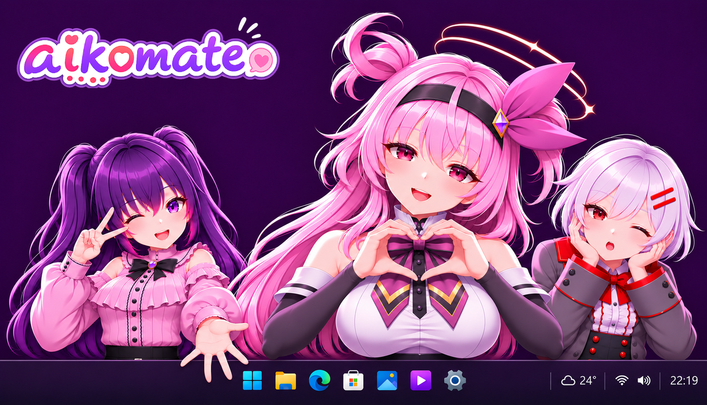

AikoMate brings **VRM 3D and Live2D characters** onto your desktop as companions you can talk to, customize, play with, and get to know. Give each character a personality and voice, invite several companions into a conversation, and choose managed cloud AI, local models, or supported providers with your own API key.

They can react, remember shared moments, notice context you choose to share, and spend time beside you while you work, study, browse, or play.

> **ℹ️ About this repository:** This is the public introduction and media showcase for AikoMate. **Application source code and installers have not been published in this repository yet.** The guide below covers the full desktop project; the later source release may have a different scope. Availability varies by app build, operating system, model, account access, and purchased features. The newest development additions are identified below.

##  A look around your desktop

<table>
<tr><th align="center">Live2D, right beside you</th><th align="center">3D companions, making themselves at home</th></tr>
<tr><td align="center"><a href="media/screenshots/desktop-live2d.jpg">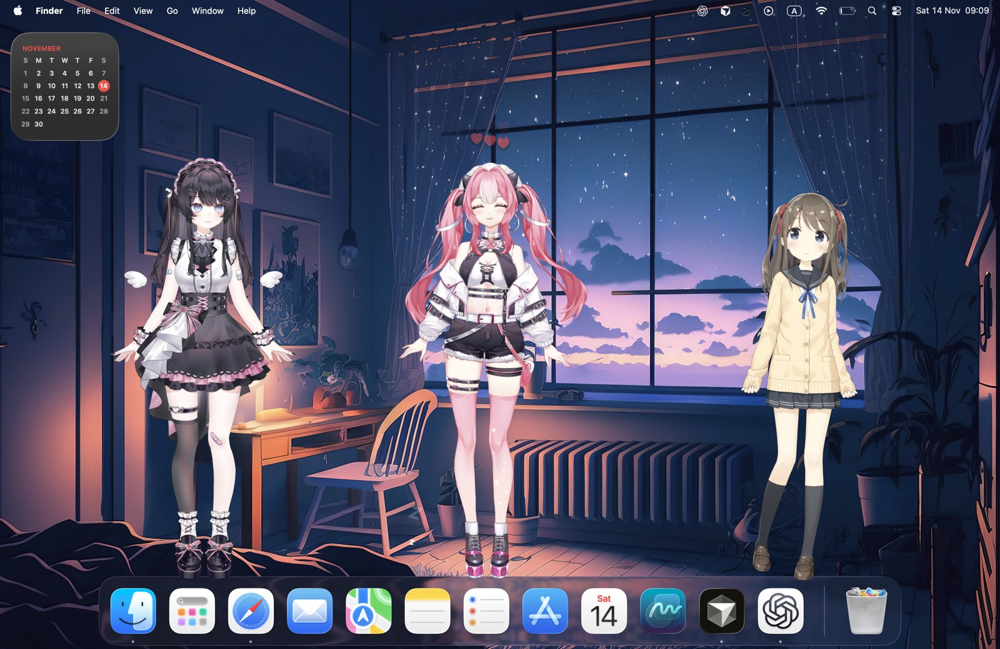</a></td><td align="center"><a href="media/screenshots/desktop-3d.jpg">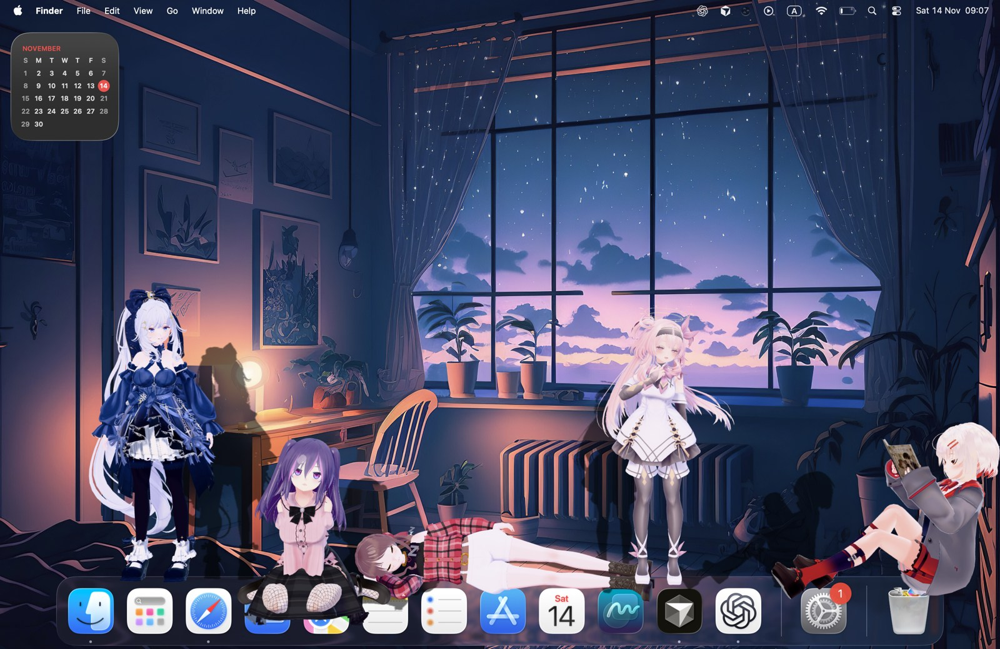</a></td></tr>
</table>

Actual app captures. Click a screenshot to view it larger; the desktop and taskbar framing is preserved.

##  At a glance

| Make them yours | Spend time together | Choose how it works |
| --- | --- | --- |
| VRM **and Live2D** characters | Text and voice conversations | Managed cloud, local AI, or BYOK |
| Personalities and individual voices | Autonomous group conversations | Independent language-model and speech choices |
| Appearance, lighting, and portraits | Character-owned memories and relationships | Optional screen, app, and browser context |
| Animation library and VRMA imports | Head pats, food, drinks, props, and ball play | Conversation pace, pause, captions, and privacy controls |
| Saved characters and templates | Idle activities, reading, resting, and music reactions | Store, inventory, community Workshop, and creator tools |

##  Meet your companions

### 3D and Live2D, both at home on your desktop

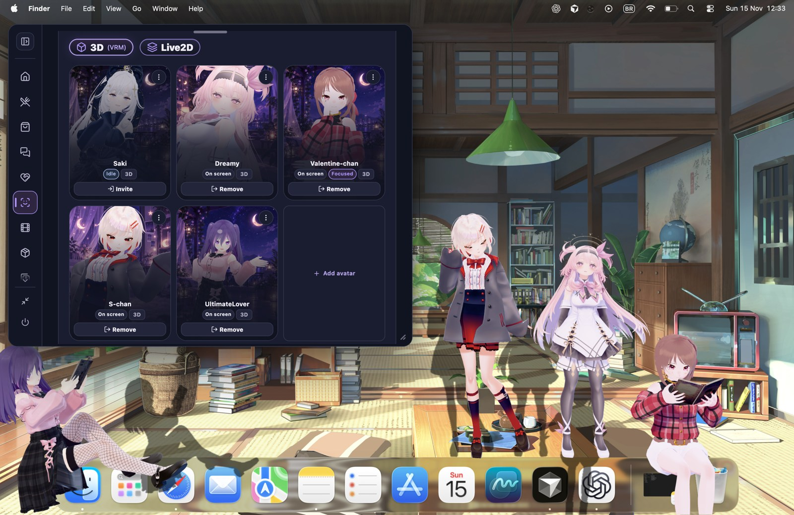

| 3D companions | Live2D companions |
| --- | --- |
| Import compatible **VRM 0.x and VRM 1.0** avatars. | Import compatible **Cubism Live2D models** with their referenced assets. |
| Animated bodies, facial expressions, lip-sync, gaze, and model-supported secondary motion. | Spoken-reply mouth movement, pointer-following gaze, and model-authored expressions and motions. |
| Desktop movement, supported surface sitting/standing, gestures, activities, and props. | Move, resize, and lock characters on your desktop; interact through head pats and supported food/drink actions. |
| Customize supported surface textures and clothing/part visibility in Character Studio. | Appearance variations depend on the controls and artwork authored into the Live2D model. |

<table>
<tr><th align="center">A little affection in Live2D</th><th align="center">A little affection in 3D</th></tr>
<tr>
<td align="center">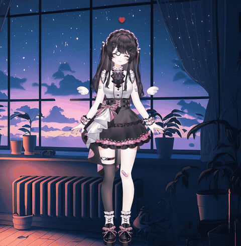</td>
<td align="center"></td>
</tr>
<tr><td align="center"><a href="media/demos/01-petting-live2d.mp4">MP4 version</a></td><td align="center"><a href="media/demos/02-petting-3d.mp4">MP4 version</a></td></tr>
</table>

###  Character Studio

- **Individual identities:** names, personalities, relationship descriptions, and independent character settings.
- **Your own cast:** create characters manually, from templates, or from owned character models; invite, focus, and remove them from the desktop without deleting their saved identity.
- **Personal voices:** choose a different voice for each companion, with separate saved Cloud and Local voice settings.
- **Appearance editing for VRM:** replace surface textures, export original or applied textures, hide supported clothing/accessories or individual mesh parts, and restore the original appearance. Available parts depend on the model; the editor does not create geometry beneath clothing.
- **Lighting and portraits:** adjust brightness and shadow, preview the character, and regenerate profile pictures with the saved appearance.
- **Desktop placement:** move and resize companions, lock their position, and use supported multiple-display layouts.

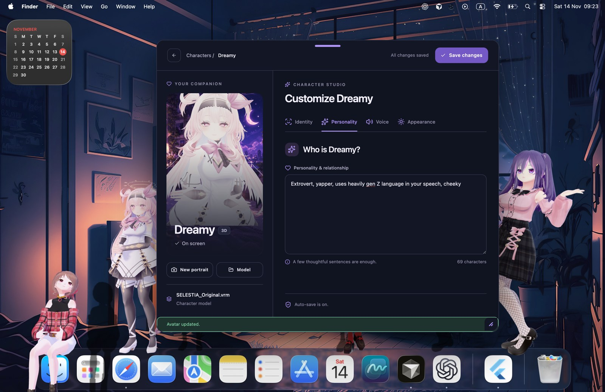

##  Conversations with personality

###  Text, speech, and a voice of their own

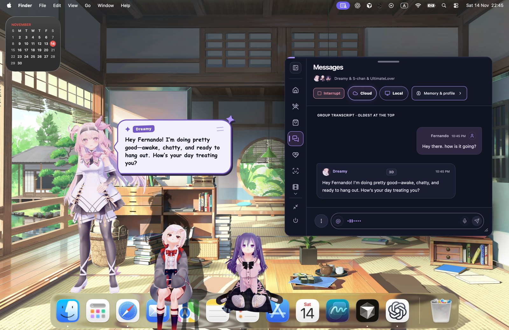

- **Type or speak:** use the Messages panel or microphone input, then read or hear the reply.
- **Personality-led replies:** character identity, personality, mood, remembered details, and the current exchange help shape how each companion responds.
- **Voices and previews:** browse the supported voice catalog, filter by language, listen to samples, and assign voices per character.
- **Speech animation:** lip-sync, expressions, and gestures accompany spoken replies where the selected character/model supports them.
- **Speaker-following captions:** speech bubbles follow the companion who is talking; adjust bubble position and caption size or hide them.
- **Conversation controls:** interrupt generation or speech, pause a conversation, and revisit the relevant Cloud or Local conversation history.

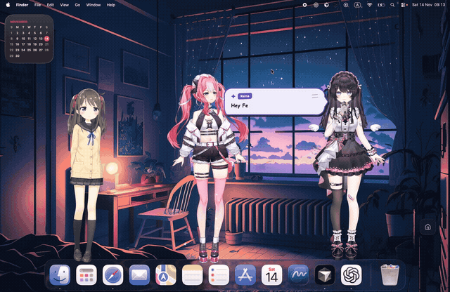

<a href="media/demos/05-talking.mp4">Talking demo — MP4</a>

###  A cast that can talk together

- Bring several companions onto the desktop and into the same public conversation.
- Address the group, mention a particular character, or start a private conversation with one companion.
- Characters can respond to you **and to one another**, nominate another speaker, ask questions, disagree, or choose to stay quiet.
- Each speaker uses their own personality, voice, mood, interests, remembered context, and relationships.
- Adjust group chatter and proactive conversation settings; you can join in, interrupt, pause, or ask for quiet.
- Public and private conversation context is kept distinct, so a private exchange is not simply shared with the whole cast.

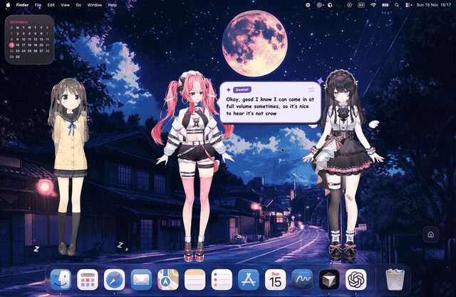

<a href="media/demos/06-group-chat.mp4">Group conversation — MP4</a>

###  Proactive companionship

Let companions start a conversation or react to a relevant opening without typing a new invitation each time. Choose a quieter, balanced, or more talkative pace, set a custom interval, or switch proactive messages off. Characters can decline an opening, and requests for quiet remain meaningful.

##  Memories, moods, and relationships

AikoMate's current character-owned memory system gives each companion their own continuity.

- **Short- and long-term context:** recent exchanges, temporary notes, facts, preferences, and shared moments.
- **Memories belong to characters:** a companion remembers what they were eligible to hear; another character does not automatically inherit it.
- **Local storage in both AI modes:** the character memory store remains on your device, including when Cloud AI is selected. Relevant context is sent to the provider used for a reply.
- **Memory controls:** view, add, edit, correct, or forget a character's memories, and explicitly assign older imported notes. Clearing a chat does not automatically erase saved memories.
- **Moods and social state:** personality, exchanges, and remembered interactions influence how companions approach later conversations.
- **Relationship progress:** stages, points, daily affection streaks and multipliers, recent memories, a seven-day activity view, and daily interaction goals.
- **Time together:** track messages, replies, accepted gifts, head pats, memories, and time spent with each companion.

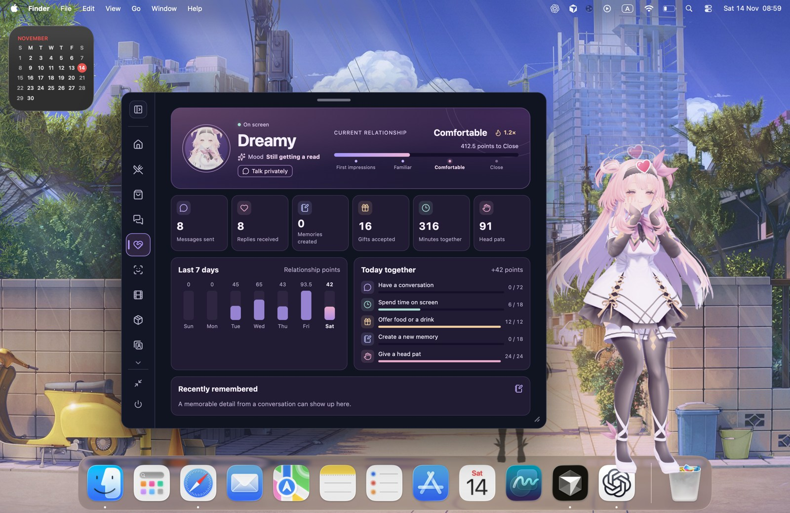

##  A little life between messages

- **Head pats and touch reactions** for supported 3D and Live2D companions.
- **Food and drinks**, with character reactions and supported group responses when someone receives a treat.
- **Hunger, thirst, and energy** systems that connect care items and activities to the companion experience.
- **Beach-ball and volleyball play** with 3D companions.
- **Desktop movement and surfaces:** supported walking, sitting, standing, and interactions around desktop windows, the dock, or taskbar.
- **Idle activities:** expressions, gestures, reading, resting, sleeping, and other supported activities continue between conversations.
- **Music reactions and dancing** with supported playback sources; platform and player support varies.
- **Props and objects:** books, toys, food, drinks, and other items that accompany supported activities.
- **Pointer interaction:** model-supported gaze, attention, and hand-following behavior.

<table>
<tr><th align="center">Snack time</th><th align="center">A quick desktop rally</th></tr>
<tr><td align="center">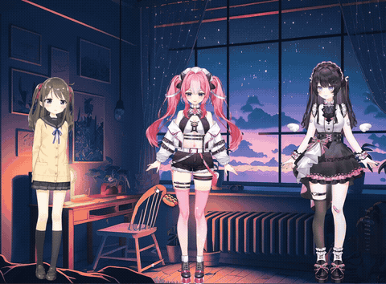</td><td align="center">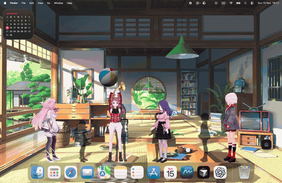</td></tr>
<tr><td align="center"><a href="media/demos/03-eating.mp4">MP4 version</a></td><td align="center"><a href="media/demos/04-volleyball.mp4">MP4 version</a></td></tr>
</table>

<table>
<tr><th align="center">Expressions & reactions</th><th align="center">Music & movement</th></tr>
<tr><td align="center"><a href="media/screenshots/expressions.jpg">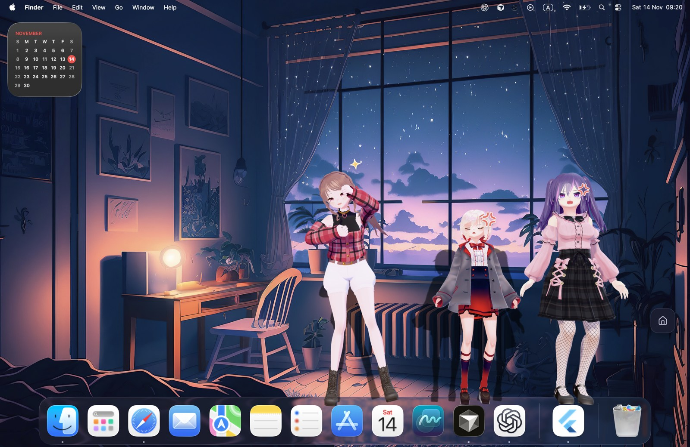</a></td><td align="center"><a href="media/screenshots/music.jpg">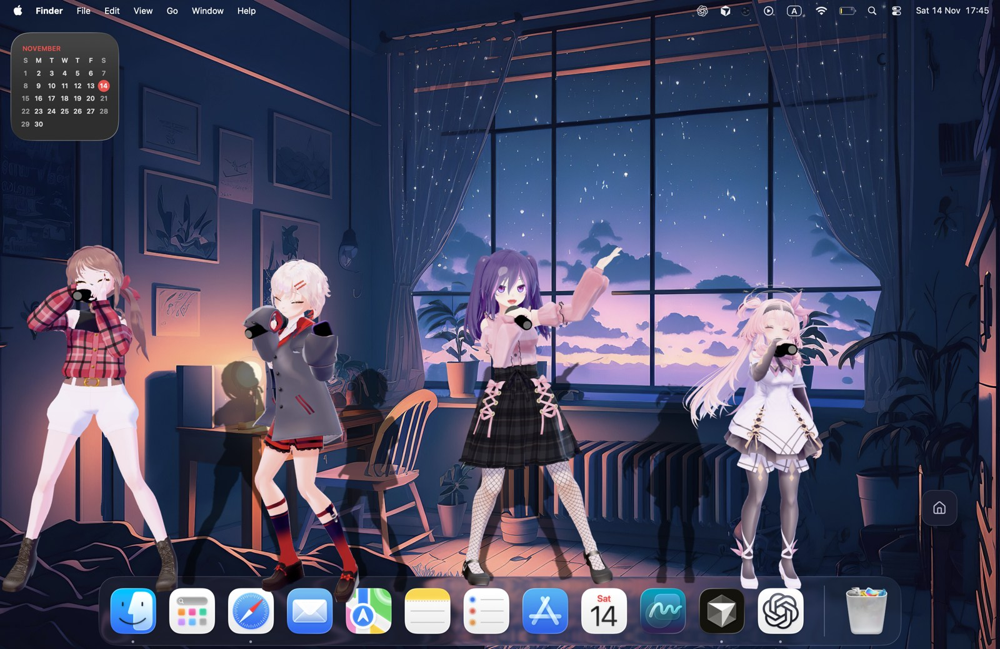</a></td></tr>
</table>

##  Choose your AI and voice

The language model and speech engine can be selected independently. You can use a managed setup, run supported models locally, or connect supported hosted services with your own API keys.

| Part of the experience | Options |
| --- | --- |
| **Managed Cloud AI** | AikoMate's cloud service, with the configured account, model, voice, and credit access. |
| **Local language models** | **Ollama** and **LM Studio**, including compatible Qwen, Llama, Gemma, and other models supported by the chosen runtime. |
| **Bring your own LLM API key** | **OpenAI, OpenRouter, Google AI Studio, DeepSeek, and xAI.** |
| **Local text-to-speech** | **Kokoro** and **Pocket TTS.** |
| **Hosted speech with your own key** | **Fish Audio** and **ElevenLabs**, with the provider's supported voice access. |
| **Microphone transcription** | Local **Faster Whisper** and the configured Cloud input path. |
| **Reference-audio voices** | Supported **Pocket TTS** voice creation from reference audio; other voice options depend on the selected provider. |

###  AI Studio and model management

- Select Cloud or Local AI and configure the chat and speech providers.
- Use the local setup flow to install or repair supported local components.
- Discover installed and recommended models, download or remove supported models, refresh the list, and select the active model.
- Use compatible **GGUF** models through the supported runtime, including already downloaded model files and configurable model locations.
- Configure provider credentials, supported model options, speech languages, and per-character voices.
- Preview local voices and keep each character's Cloud and Local voice selections separate.

**Availability:** local models need downloads, setup, disk space, and suitable hardware. Hosted providers require internet access and their own API access/charges. The managed desktop app's Local AI Mode is an account/entitlement-controlled feature; selecting it does not by itself mean the commercial app is an account-free distribution. Speech languages, vision, reasoning options, and voice cloning depend on the engine and model.

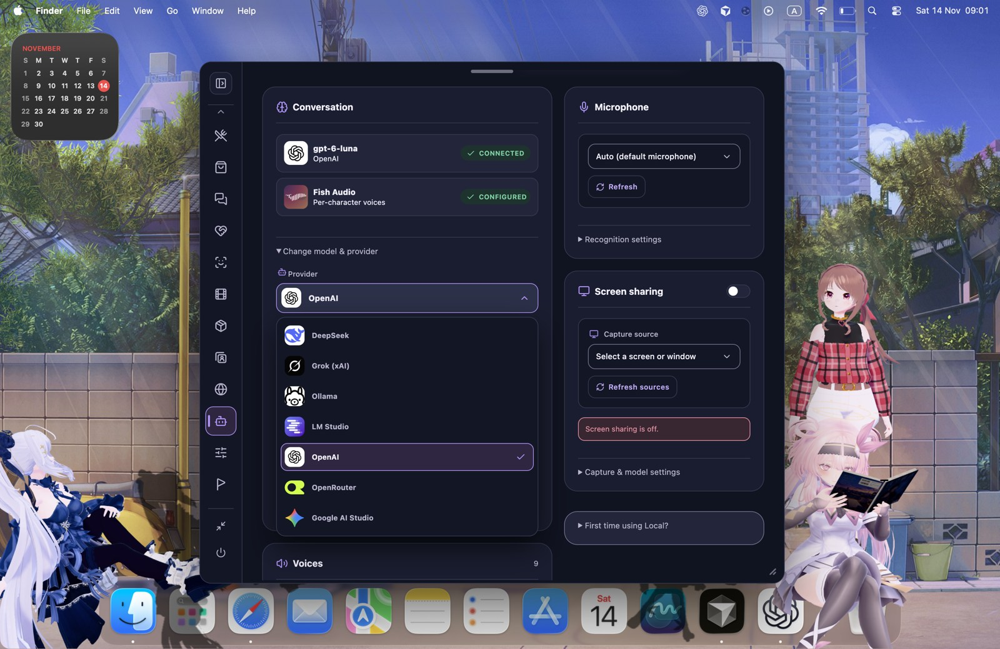

<table>
<tr><th align="center">Choose your speech engine</th><th align="center">Find their voice</th></tr>
<tr><td align="center"><a href="media/screenshots/local-voices.jpg">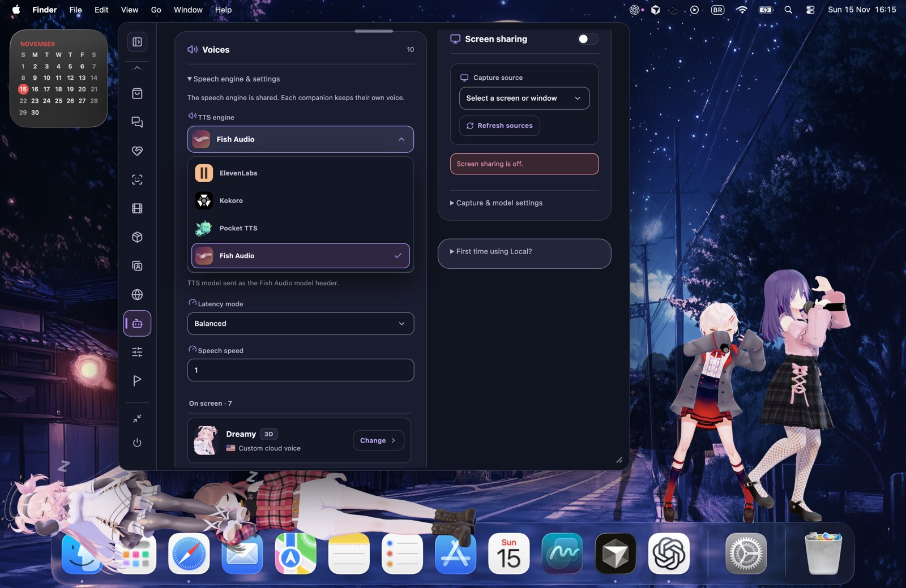</a></td><td align="center"><a href="media/screenshots/voice-catalog.jpg">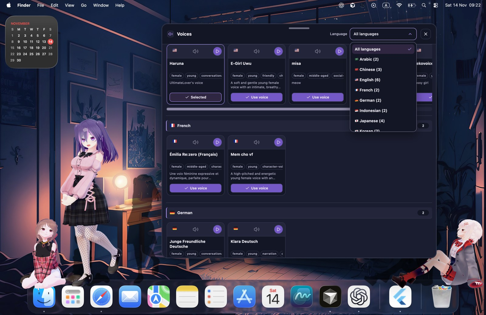</a></td></tr>
</table>

##  Desktop Vision and optional awareness

### Show what you choose

Share a screenshot, a selected area, or supported screen-sharing context, then ask about what is visible. Desktop Vision can help discuss a page, image, app, or task on your screen. It requires a compatible AI model and configuration, plus the relevant operating-system permissions.

### Let companions notice your context

The newest desktop work adds two independently optional settings:

| Setting | What it shares | Current scope |
| --- | --- | --- |
| **Focused app awareness** | The focused app's identity and approximate time in focus. It does not itself capture screenshots, window titles, page contents, or browser tabs. | Platform-dependent; unsupported environments keep ordinary companionship working. |
| **Browser awareness** | Titles and site names from eligible normal browser tabs, shared with the selected AI provider. Private/incognito tabs, full URLs, and page contents are excluded. | Current native adapter: **Chrome, Edge, Brave, and Chromium on macOS direct/Steam builds**, with explicit OS permission. Safari, Firefox, Windows, Linux, and Mac App Store native tab access are not currently supported. |

Both settings default to off. Raw activity observations are temporary and are not saved as an app-usage or browsing-history log; ordinary spoken comments can still appear in conversation history. Cloud and BYOK configurations send the relevant shared context to the selected provider. Native permissions and packaged-build availability remain build-specific.

##  Animation library and creator tools

- Browse built-in motions and activity animations, with previews and searchable categories.
- Import compatible **VRMA** animations, preview them on a character, organize animation sets, and enable the movements you want to use.
- Use the linked **[AikoMate Animation Editor](https://aikomate.com/animation-editor)** to pose VRM characters, work with keyframe animation, and add expressions. Editor access is a separate product entitlement where applicable.
- Regenerate character portraits and reuse saved character templates.

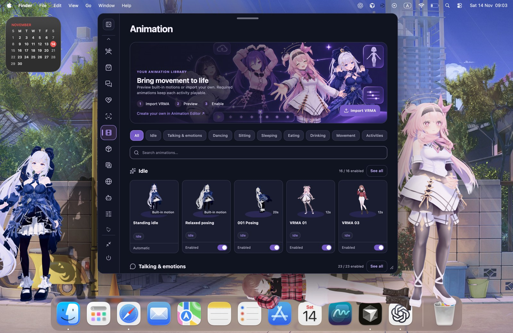

##  Store, inventory, and community

- **Character and item catalog:** browse supported characters, props, consumables, and product offers, then manage owned items in the inventory.
- **Independent characters from owned models:** create another companion from the same owned model without replacing an existing character's personality or saved identity.
- **Daily credit rewards** and account balance information in the supported service/distribution.
- **Community Workshop:** browse approved **VRM and Live2D** submissions, search and sort the catalog, preview listings, and use favorites and collected characters where your access allows.
- **Share characters:** supported Workshop uploads include model format detection, optional covers, tags, sharing-rights declarations, review status, and private moderator feedback.
- **Creator credit controls:** public submissions are anonymous by default, with opt-in public credit. Submissions are reviewed before publication.
- **Protected in-app character access:** Workshop collection, preview, download, sharing, and favorite capabilities follow the current Workshop VIP and per-character access rules.
- **Creator tools and account products:** supported purchases, collections, upgrades, and website Animation Editor redemption follow the relevant product access.
- **Steam achievements** in the Steam edition for supported companion and interaction milestones.
- **Community and support:** links to the website, Discord, videos, project updates, and in-app feedback.

##  Everyday controls

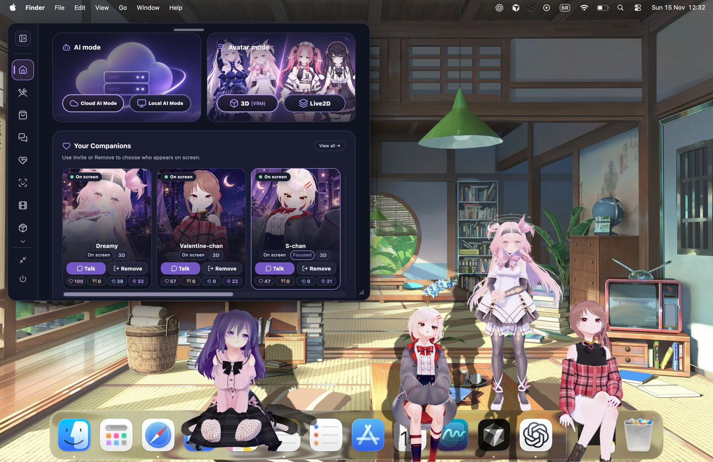

- A guided **character → personality → voice** setup for both 3D and Live2D.
- An optional guided tour, contextual exploration tips, and the ability to replay setup or the tour.
- Movable and resizable floating controls, plus desktop click-through outside active controls.
- Multiple interface languages, adjustable caption size/position, and an FPS target.
- Permission controls for microphone, screen, selected files, and optional desktop/browser context.
- Pause or disable proactive conversation, tune group chatter, and choose when to share visual context.

##  Latest desktop development

These additions are present in the current development project and may arrive in packaged/store builds at different times:

| Update | What it adds |
| --- | --- |
| **Expanded saved roster** | No fixed saved-character count limit; up to **six on-screen characters in the selected 3D or Live2D mode across all displays**. Additional characters stay saved off screen. |
| **Character-owned memory controls** | Separate remembered facts, preferences, shared moments, and temporary notes, with add/edit/forget and explicit older-memory import. |
| **Appearance studio** | Per-character textures and clothing/part visibility, full-resolution texture export, orientation controls, portrait refresh, and improved preview loading. |
| **Experimental FBX and Unity package import** | Local conversion of a supported humanoid FBX, including an FBX selected from a Unity package, into a VRM for use in AikoMate. Basic materials, textures, recognizable expressions, and supported secondary bones are handled when present. **This does not reproduce an assembled Unity prefab, execute package scripts, or guarantee exact shader/physics fidelity.** |
| **Context-aware companionship** | Independent app/browser awareness controls and revised proactive conversation scheduling. |
| **Conversation improvements** | Personality-led speaker participation, private/group separation, interruptions, speaker-following captions, and stronger character memory isolation. |

##  Demo gallery

<strong>Watch a character change</strong>

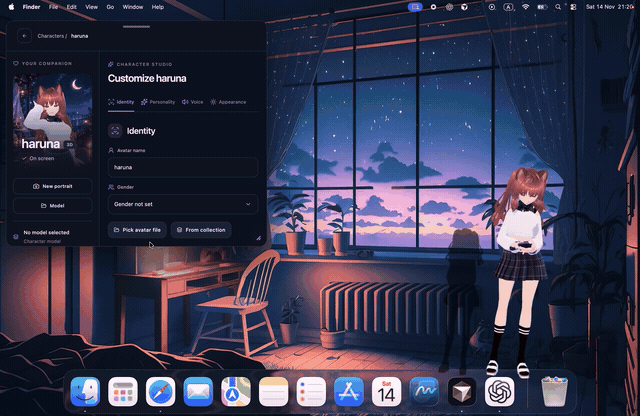

[Character change — MP4](media/demos/07-character-change.mp4)

All seven prepared clips are available as looping GIFs above and as MP4 files:

| Demo | GIF | MP4 |
| --- | --- | --- |
| Live2D head pats | [GIF](media/demos/01-petting-live2d.gif) | [MP4](media/demos/01-petting-live2d.mp4) |
| VRM head pats | [GIF](media/demos/02-petting-3d.gif) | [MP4](media/demos/02-petting-3d.mp4) |
| Food and reactions | [GIF](media/demos/03-eating.gif) | [MP4](media/demos/03-eating.mp4) |
| Desktop volleyball | [GIF](media/demos/04-volleyball.gif) | [MP4](media/demos/04-volleyball.mp4) |
| Talking | [GIF](media/demos/05-talking.gif) | [MP4](media/demos/05-talking.mp4) |
| Group conversation | [GIF](media/demos/06-group-chat.gif) | [MP4](media/demos/06-group-chat.mp4) |
| Character switching | [GIF](media/demos/07-character-change.gif) | [MP4](media/demos/07-character-change.mp4) |

Clips are trimmed and muted for a quick demonstration. The talking clip plays at **1.4× speed**; selection/loading delays were removed from the character-change clip. These are product demonstrations, not performance benchmarks. Some screenshots show an earlier UI revision than the newest features described here.

##  Project status

This repository currently contains **the README and presentation media only**. No application source, model packages, API keys, local profiles, or installers are included. GitHub Pages remains unpublished.

The page introduces the **full AikoMate desktop experience**, including Live2D, cloud AI, local AI, and supported hosted integrations. It does not claim that the separately prepared local-only source export already contains every managed-app feature. The eventual source release and its supported feature set will be announced here when ready.

[Visit AikoMate](https://aikomate.com/) · [View on Steam](https://store.steampowered.com/app/4426320/AikoMate/)

Brand artwork, demo recordings, and third-party characters retain their own rights. Publishing this showcase does not relicense the application, Live2D SDK, avatars, animations, voices, or other third-party assets. See [media notes](media/README.md).
